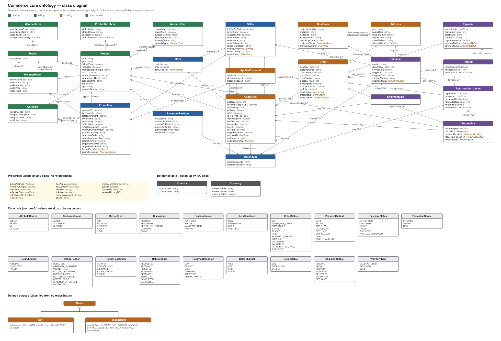
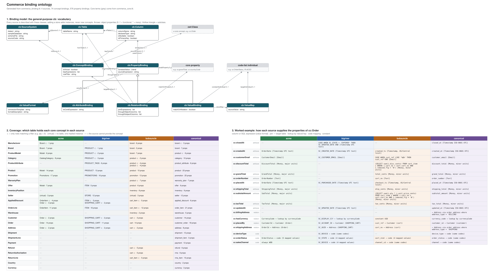

# OntoMapResearch

## Goal

The goal of the project is to explore how agents should use skills and tools with ontologies in data engineering. A common task in data engineering is ingesting data and normalizing it to a canonical model.

In healthcare, database schemas often have thousands of tables. Every company has their own conventions and standards for modeling. This means systems that handle health data from multiple sources have to transform multiple variations into 1 canonical format. Building ontologies can take years when you try to boil the ocean, which isn't practical for situations where engineers have to deliver within tight deadlines.

The approach here is deliberately small: model only the concepts that the schemas in front of you actually contain, keep the business meaning separate from where each database stores it, and give agents a tool that answers mapping questions from the ontology instead of letting an LLM guess. The experiment uses three e-commerce sources with very different modeling habits (`acme_shopping.sql`, `big_river.sql`, `bobs_uncle.sql`), a canonical target (`canonical_ecommerce.sql`) and fictional sample data for each.

The ontology is split in two:

| | Concept ontology | Binding ontology |
|---|---|---|
| File | `ontology/commerce_core.ttl` | `ontology/commerce_binding.ttl` |
| Answers | *What* is an order, a promotion, a return? | *Where* and *how* does each store keep it? |
| Changes when | The business adds a concept | A store is added or its schema changes |
| Knows about databases | No | Yes |

### Concept Ontology

`commerce_core.ttl` describes the commerce domain independently of any database. It was derived from the concepts found across the three sources and the canonical model, not designed top-down, so it stays small enough to build in days rather than years.

- **Concepts:** 25 classes, for example Product, Brand, Manufacturer, Order, OrderLine, Promotion, AppliedDiscount, Shipment and ReturnAuthorization. Each has a definition and `skos:altLabel`s for the words the sources use for it (Acme calls a product a "Model", BigRiver an order line an "ITEM", BobsUncle an order a "cart"). Those alternative names help an agent recognise a concept in an unfamiliar schema.
- **Properties:** 81 relationships and 136 attributes, each with a domain and range. Monetary values are sub-properties of `cc:monetaryAmount` and identifiers of `cc:identifier`, so they can be found as a group.
- **Code lists:** 19 controlled vocabularies (order status, sales channel, funding source, return reason, ...) with 102 values. Each value's `skos:notation` is its canonical code.
- **Defined classes:** `cc:Cart` and `cc:PlacedOrder` are defined from the order status. A cart is an order that hasn't been placed yet, which is how all three sources actually behave.
- **Value conventions, stated once:** money in major currency units, percentages as fractions, timestamps in UTC, weight in grams, flags as booleans. Every binding converts into these, so no mapping has to know about any other store's format.

The ontology is generated from `ontology/core_spec.py` by `ontology/build_ontologies.py`. `ontology/competency_questions.md` lists 30 questions it must be able to answer, each with a SPARQL query. Examples: "How is a product connected to its manufacturer?" and "Which identifiers can match a product across stores?".



### Binding Ontology

`commerce_binding.ttl` maps the concepts onto real tables and columns. It has two parts:

1. **A general-purpose vocabulary (`cb:`)** that knows nothing about commerce:
   - `cb:ConceptBinding`: which rows of which table are instances of a core class (table, key expressions, optional row filter).
   - `cb:AttributeBinding`: which column or SQL expression gives a property, and in which `cb:ValueFormat`.
   - `cb:RelationBinding`: how a row links to another concept (foreign key, join table, or lookup by an ISO code).
   - `cb:ValueBinding`: how source codes map to code-list values.
   - `cb:ValueFormat`: how a format is stored (cents, `'YYYYMMDD'` text, Y/N flags, US/Central local time, ...), with SQL templates to convert it into the core convention and back.
2. **Bindings for each schema:** AcmeShopping, BigRiver, BobsUncle and the canonical model. That's 74 concept bindings and 576 property bindings. The canonical model is bound like any other source, so nothing treats it as special.

For example, BobsUncle's order grand total is bound like this:

```turtle
bobsuncle:Order__grandTotal
    a cb:AttributeBinding ;
    cb:ofConceptBinding bobsuncle:Order ;      # rows of table "cart"
    cb:bindsProperty cc:grandTotal ;
    cb:sourceColumn bobsuncle:column_cart__total_cents ;
    cb:valueFormat cb:MoneyMinor ;
    cb:toCoreExpression "\"total_cents\" / 100.0" .
```

The bindings capture the messy parts explicitly, so an agent doesn't have to rediscover them:
- **Concepts hidden in other tables:** BobsUncle return lines are `cart_item` rows with `qty < 0`.
- **Concepts with no table:** Acme has a single implied seller.
- **Free-text values that need cleansing:** seller-typed brands, hand-typed countries.
- **Values SQL can't convert:** local-time timestamps.

The bindings are generated from `ontology/binding_spec.py`. The build fails unless every one of them is valid:
- every table, column, key, filter and SQL expression is executed against the real schema
- every property must suit the concept it's bound on
- every code value that occurs in the sample data must have a mapping

Adding a new store means adding one `Source(...)` to `binding_spec.py`; the concept ontology doesn't change.



## Agents.md and Skills

Left alone, an LLM asked to write ETL guesses the mapping between two schemas from column names. That's slow to review, and it fails silently on exactly the cases that matter: a "Model" table that is really a product, cents versus dollars, `'C'` meaning "checked out", local time stored without a zone. In this project an agent **looks the mapping up first, and guesses only what the ontology can't answer**.

**The tool: `ontology/mapping_service.py`.** It loads both ontologies at start-up (about 0.2 s), then takes a source and a target SQL schema script and returns the mapping as JSON:
- **Identification:** which known system each script is, and any schema drift (renamed, missing or new columns).
- **For every concept both sides share:**
  - the table-to-table mapping, with keys and row filters
  - property-to-column mappings, each with a ready-to-run SQL `transform` that converts source format → core → target format, e.g. `CAST(ROUND("GrandTotal" * 100) AS INTEGER)`
  - complete code tables, e.g. BobsUncle `'C'` → `PLACED`
  - instructions for foreign keys and join tables
- **Validation:** every transform is executed against the submitted source schema, and every entry is tagged `"resolved_by": "ontology"`.
- **An `unresolved` section** lists exactly what is left for the LLM: target fields with no source, concepts only one side has, unused columns, drift, and mappings that need a human or the ETL tool (for example `manual_conversion_required` for US/Central timestamps).
- **Unknown schemas** get name-similarity hints only, explicitly marked as suggestions.

It runs as an HTTP service on localhost (`POST /map`, `/identify`; `GET /sources`, `/concepts`, `/health`) or from the command line.

**The instructions:**
- [`AGENTS.md`](AGENTS.md) sets the rules for any agent working in the repository:
  - call the mapping tool first
  - use ontology mappings exactly as returned
  - infer only items under `unresolved`
  - label every guess `"provenance": "llm-guess"` with a reason and a confidence
  - report schema drift
  - propose confirmed guesses as new bindings, so the next run resolves them from the ontology
- [`.claude/skills/ontology-mapping/SKILL.md`](.claude/skills/ontology-mapping/SKILL.md) is the skill that teaches an agent how to use the tool:
  - how to call it
  - what every JSON field and status means
  - what to do in each case, including an unknown schema
  - how to report provenance
  - a real example

  It sits where Claude Code discovers project skills; other agent frameworks can load the same file.

**What testing showed.** Across all 12 source/target pairs, the tool returned 1,038 mappings and every transform validated. On the sample data, each source converts all 500 orders with totals that add up. Two failure modes showed why a tool beats guessing:
- **SQLite silently treats a misspelled `"Column"` as a string literal.** A renamed column would therefore have looked valid. The tool now disables that and checks every column explicitly.
- **BobsUncle's local timestamps would have been labelled UTC,** 5–6 hours off. The ontology knows that format can't be converted in SQL, so the tool now refuses to call it mapped.

### Getting started

Create the Python environment once, with conda:

```bash
conda env create -f environment.yml
```

```bash
conda activate ontomap
```

or with a virtual environment:

```bash
python3 -m venv .venv && .venv/bin/pip install -r requirements.txt
```

```bash
source .venv/bin/activate
```

`requirements.txt` installs `rdflib` (ontologies, mapping service, diagrams) and `dbt-core` with `dbt-sqlite` (the models in `dbt/`). Run the commands below with the environment activated.

```bash
# map a source schema onto the canonical model (JSON to stdout)
python ontology/mapping_service.py map --source bobs_uncle.sql --target canonical_ecommerce.sql --concept Order
```

```bash
# or run the HTTP service on 127.0.0.1:8765
python ontology/mapping_service.py serve
```

```bash
# after editing core_spec.py or binding_spec.py: rebuild, validate and re-run the competency questions
python3 ontology/build_ontologies.py && python ontology/run_competency_questions.py
```


